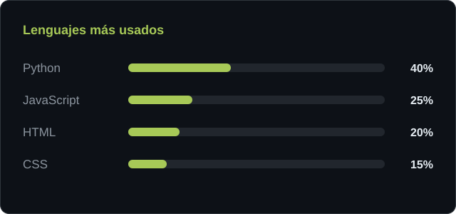

<!--
  CÓMO USAR ESTE ARCHIVO
  1. Sube hola.gif, mascota.png y lenguajes.svg a la raíz de este repositorio.
  2. Cambia TU-CORREO, TU-PERFIL y los textos entre corchetes.
  3. Sube .github/workflows/serpiente.yml para activar la serpiente.
-->

  

<h1 align="center">Hola, soy Javiera ✨</h1>

  

<table>
  <tr>
    <td width="58%" valign="middle">
      <pre>
💼 Mi nombre es Javiera y estoy estudiando en la Universidad de Santo Tomás
💻 Aprendiendo Python · HTML · CSS · JavaScript
📖 Interesada en desarrollo web y datos
🎮 Series · música · café
🐾 miau miau miau
      </pre>
    </td>
    <td width="42%" align="center">
      
    </td>
  </tr>
</table>

  
  
  

<h3 align="center">🛠️ Tecnologías</h3>

  

<!-- La serpiente aparece cuando la GitHub Action se ejecuta por primera vez. -->
<table>
  <tr>
    <td width="50%" align="center" valign="middle">
      
    </td>
    <td width="50%" align="center" valign="middle">
      <picture>
        <source media="(prefers-color-scheme: dark)" srcset="https://raw.githubusercontent.com/faxis4/faxis4/output/github-contribution-grid-snake-dark.svg" />
        <source media="(prefers-color-scheme: light)" srcset="https://raw.githubusercontent.com/faxis4/faxis4/output/github-contribution-grid-snake.svg" />
        
      </picture>
    </td>
  </tr>
</table>
